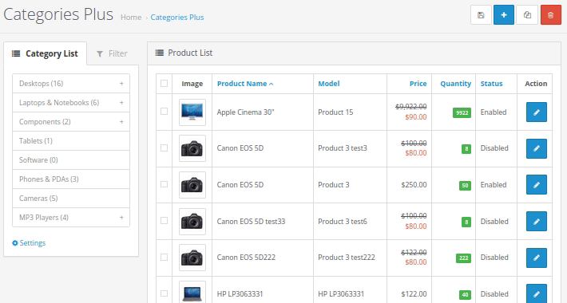

# Categories Plus — Admin Editor for OpenCart 3.x

**Categories Plus** is an archived extension for OpenCart 3.x that provides a more convenient way to manage categories and products directly from the OpenCart administration panel.

The extension was originally developed and distributed by **0001.pro**.

> **Archive status:** This project is preserved for historical and compatibility purposes. It is no longer actively developed or supported.

## Features

- Hierarchical category tree with unlimited nesting levels
- Multi-store support
- Quickly find products using the category tree
- Create and copy products directly from the active category
- Edit product attributes directly in the product list
- Edit product prices and quantities directly in the product list
- Move products between categories using Drag & Drop
- Move subcategories using Drag & Drop
- Built-in product search and filtering
- Display products from the current category or from the current category and all its subcategories
- Configurable maximum module height
- Navigate the category tree directly from the administration panel

## Screenshot

## Compatibility

The extension was released for the following OpenCart 3.x versions:

- 3.0.0.0
- 3.0.1.1
- 3.0.1.2
- 3.0.2.0
- 3.0.3.0
- 3.0.3.1
- 3.0.3.2
- 3.0.3.3
- 3.0.3.5
- 3.0.3.6
- 3.0.3.7
- 3.0.3.8

## Installation

1. Open the OpenCart administration panel.
2. Go to **Extensions → Installer**.
3. Upload the original `categoriesplus-v3.x.ocmod.zip` package.
4. Open **Extensions → Extensions**.
5. Select the appropriate extension type and enable **Categories Plus**.
6. Open **Catalog → Categories Plus**.

The original `.ocmod.zip` package included in this repository is preserved as the installation package and should not be modified or repacked.

## Uninstallation

The extension can be removed using the standard OpenCart extension/module management tools.

## Historical distribution

The extension was originally published in the **0001.pro Marketplace** on **2021-09-16** as a paid extension.

Historical statistics recorded by 0001.pro:

- **Price:** 9
- **Downloads:** 8

The extension was also independently published on the **OpenCart Marketplace** as extension **#42655**.

Historical OpenCart Marketplace statistics:

- **Sales:** 12

These figures represent statistics from two separate distribution platforms and are intentionally shown separately. The figures are not combined.

## Repository contents

This repository preserves:

- the original `categoriesplus-v3.x.ocmod.zip` installation package;
- the unpacked contents of the package for source-code inspection;
- original screenshots and the extension logo;
- this README with historical project information.

The original ZIP package is preserved unchanged.

## License and support

This repository is an archive of the original project. No new license is granted by the creation of this repository.

The extension is provided **as is**. Active technical support and further development are not provided.

## Author

**0001.pro**

https://0001.pro/
